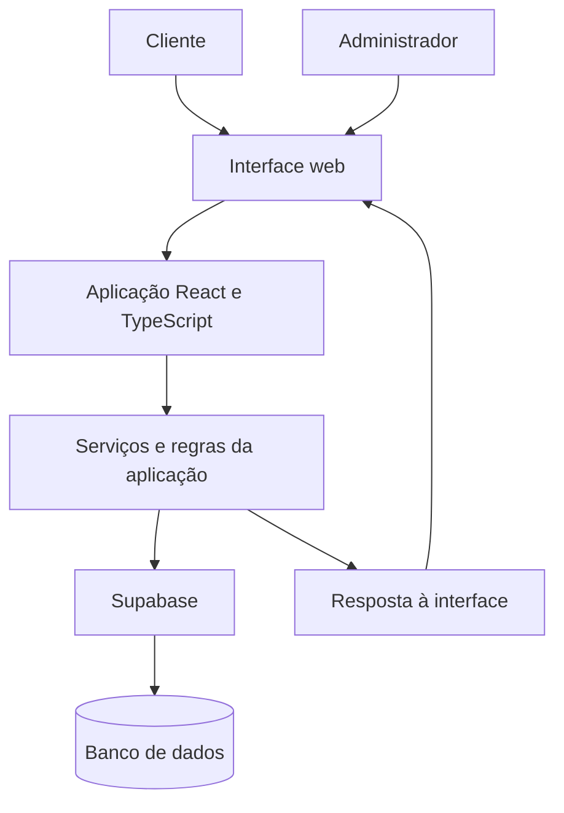

# 5. Arquitetura do sistema

## 5.1 Visão geral

O projeto é uma aplicação web desenvolvida com React e TypeScript. O repositório também declara o uso de TanStack Start, TanStack Router e Vite. A integração com serviços Supabase é indicada pela dependência @supabase/supabase-js e pela presença da pasta supabase.

Em alto nível, a solução pode ser compreendida em três partes:

1. **Camada de apresentação:** páginas, componentes e formulários exibidos ao cliente e ao administrador.
2. **Camada de aplicação:** regras de interação, validações, controle de navegação e coordenação das operações.
3. **Serviços e persistência:** recursos do Supabase e estruturas de banco de dados utilizadas pela aplicação.

Essa divisão é uma visão conceitual. A organização interna exata deve ser conferida nos módulos existentes em src/, supabase/ e drizzle/.

## 5.2 Tecnologias e responsabilidades

| Tecnologia | Responsabilidade no projeto |
|---|---|
| React | Construção da interface por componentes. |
| TypeScript | Tipagem estática e apoio à manutenção do código. |
| TanStack Start | Estrutura da aplicação web. |
| TanStack Router | Gerenciamento de rotas e navegação. |
| Vite | Ferramenta de desenvolvimento e build. |
| Supabase JS | Comunicação com os serviços Supabase. |
| Tailwind CSS | Estilização da interface. |
| Drizzle ORM / Drizzle Kit | Ferramentas de modelagem e gerenciamento de banco, conforme configuração do projeto. |
| Vitest | Execução de testes automatizados. |

## 5.3 Fluxo conceitual de pedido

1. O cliente acessa o catálogo.
2. Consulta os detalhes de um cupcake.
3. Seleciona as opções de personalização disponíveis.
4. Adiciona o produto ao carrinho.
5. Revisa os itens escolhidos.
6. Informa ou confirma os dados solicitados.
7. Envia o pedido.
8. Consulta o andamento do pedido, quando essa funcionalidade estiver disponível.

## 5.4 Diagrama simplificado

O diagrama representa a visão lógica geral e não substitui um diagrama de implantação ou a análise detalhada do código.
