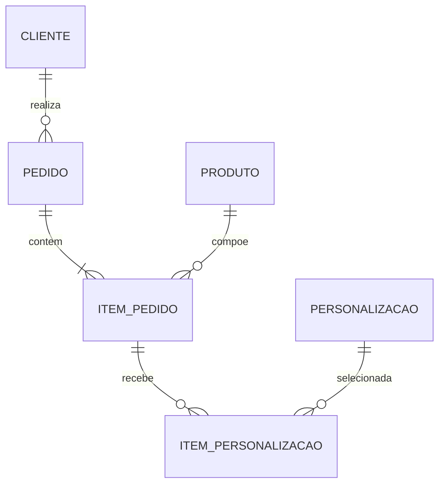

# 6. Modelagem e persistência de dados

## 6.1 Visão geral

O repositório contém diretórios denominados supabase/ e drizzle/, além das dependências do Supabase JavaScript Client, Drizzle ORM e Drizzle Kit. Isso indica a presença de recursos relacionados à integração e à estrutura de dados.

## 6.2 Entidades conceituais

Para atender ao escopo descrito, o domínio do sistema envolve conceitos como:

- **Cliente:** pessoa que utiliza a loja.
- **Produto:** cupcake disponibilizado no catálogo.
- **Personalização:** opção escolhida para compor um produto.
- **Carrinho:** seleção temporária de itens antes da confirmação.
- **Pedido:** solicitação registrada pelo cliente.
- **Item do pedido:** produto, quantidade e escolhas associadas a um pedido.
- **Usuário administrativo:** pessoa autorizada a realizar operações de gestão.

A lista acima é uma modelagem conceitual de domínio, não uma afirmação sobre os nomes ou a existência de tabelas específicas no banco atual.

## 6.3 Relacionamentos conceituais

- Um cliente pode realizar vários pedidos.
- Um pedido pode conter vários itens.
- Cada item de pedido referencia um produto.
- Um item pode possuir uma ou mais personalizações, conforme as opções suportadas.
- Usuários administrativos possuem permissões específicas para operações de gestão.

## 6.4 Diagrama conceitual

Este diagrama expressa relações conceituais. A cardinalidade e as tabelas reais devem ser verificadas nas migrations e no schema do banco antes de serem utilizadas como documentação física.

## 6.5 Como validar o modelo físico

Para concluir esta seção com precisão:

1. Conferir os arquivos SQL de supabase/ e drizzle/.
2. Identificar tabelas, colunas, tipos, chaves primárias e estrangeiras.
3. Conferir restrições NOT NULL, valores padrão e índices.
4. Verificar políticas RLS e permissões de leitura e escrita.
5. Comparar o schema versionado com o banco utilizado pela aplicação.
6. Atualizar o diagrama com os nomes e relacionamentos efetivamente existentes.

Não incluir senhas, chaves privadas ou dados pessoais reais nos diagramas ou exemplos.
